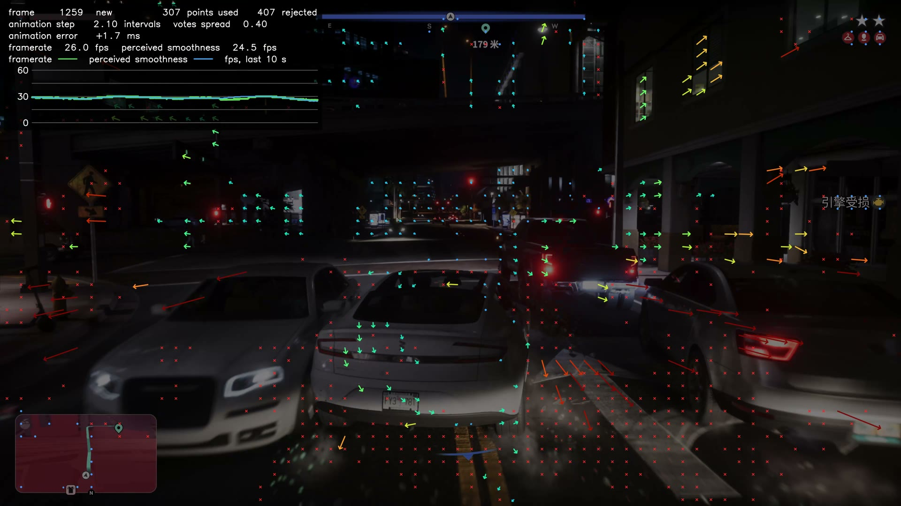
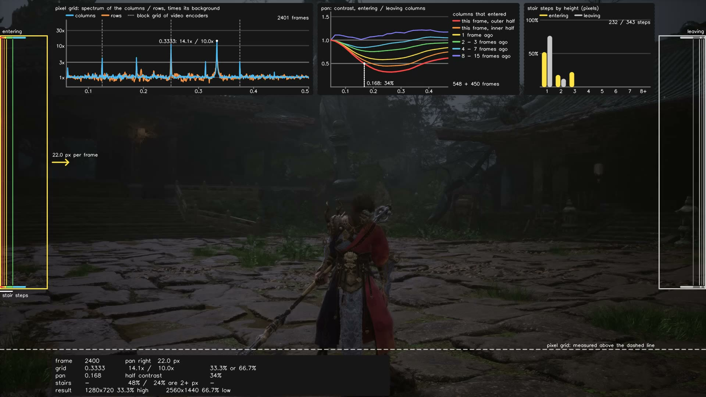

# fresniff

Analyzes captured game video:

* the *real* framerate and frametime of a capture, and frame tears;
* how evenly the animation advances, from the motion between the frames
  ([perceived smoothness](#motion-analysis---motion), `--motion`);
* the [render resolution](#render-resolution---resolution) behind upscaling, including temporal upscalers
  (DLSS, FSR 2 and later, XeSS, TSR, PSSR) (`--resolution`).


*[Motion video](#motion-video---motion-video): the tracked motion, the values of the frame and the framerate of the last 10 seconds*


*[Resolution video](#render-resolution---resolution): the traces of the render resolution and the candidates found so far*

The per frame data is written as CSV, a summary goes to stderr, and [Python scripts](#plotting) plot it.
Optionally the analysis runs on the GPU (Vulkan), including the decoding of HEVC / H.264 recordings.

## Usage

```
fresniff [options] <video> [<video> [<video>]]
```

| option | description |
| --- | --- |
| `-o, --output <file>` | per frame CSV (default / `-`: stdout) |
| `--tears <file>` | additional CSV with one row per detected tear |
| `--pixel-diff <0-255>` | difference a pixel may have without counting as different (default `0`, lossy codecs `4`) |
| `--tolerance-pct <%>` | a frame only counts as new if more than this share of its pixels changed (default `0`, lossy codecs: automatic, see [lossy recordings](#lossy-recordings)) |
| `--keyframe-tolerance <x>` | with the automatic tolerance: a [keyframe](#lossy-recordings) only counts as new if it changed more than x times the least of the last 3 new frames (`0` - `1`, `0`: off, default `0.5`) |
| `--dismiss-tear-pct <%>` | tears smaller than this share of the frame height are dismissed (default `10`) |
| `--source-fps <fps>` | override the recorded framerate of the container |
| `--max-frames <n>` | stop after n frames |
| `--lossless` | the videos were recorded lossless, whatever the codec: a duplicate frame is identical, and `--resolution` also reads the peaks that encoders would leave |
| `--motion` | [motion analysis](#motion-analysis---motion): animation step, animation error, perceived smoothness |
| `--motion-window <ms>` | fixed length of the window a frame's motion is compared to (default 400, longer for low framerates) |
| `--motion-video <file>` | `--motion`, and write a [copy of the video with the motion drawn on it](#motion-video---motion-video) |
| `--motion-video-native` | the motion video at the input's resolution (4K stays 4K) instead of 1080p at most |
| `--arrow-scale <x>` | draw the arrows of the motion video x times longer (default `1`) |
| `--async-capture` | `--motion` for a [capture that didn't run in step with the game's output](#captures-that-are-not-in-step---async-capture) |
| `--ignore-clock-skew` | filter only what [a 59.94 Hz source recorded at 60 fps](#clock-skew---ignore-clock-skew) does every 16.7 s |
| `--resolution` | `--motion`, and estimate the [render resolution](#render-resolution---resolution) |
| `--resolution-grid-rows <a-b>` | the part of the height (percent, from the top) the pixel grid is measured in (default `0-88`) |
| `--resolution-pan-rows <a-b>` | the part of the height the edge columns of a pan are measured in (default `9-74`) |
| `--resolution-data <file>` | `--resolution`, and write [what the estimate is made of](#render-resolution---resolution) as CSV |
| `--resolution-video <file>` | `--resolution`, and write a [copy of the video that shows how the estimate is made](#render-resolution---resolution) |
| `--no-summary` | don't print the summary to stderr |
| `-q, --quiet` | no progress / input info on stderr |
| `--vkdevice <n>` | Vulkan device to use (default: the first discrete GPU). Vulkan builds only |
| `--no-vk` | analyze with OpenCV on the CPU |
| `--list-vkdevices` | list the Vulkan devices and exit. Vulkan builds only |
| `--decode <mode>` | `auto` (default: the fastest), `vulkan`, `ffmpeg` or `opencv`, see [GPU decoding](#ffmpeg--vulkan-video-gpu-decoding). FFmpeg builds only |

Up to 3 videos are read in lockstep, and the analysis stops when the shortest one ends. Options that are
set per video (`--pixel-diff`, `--tolerance-pct`, `--keyframe-tolerance`, `--dismiss-tear-pct`,
`--source-fps`, `--resolution-*-rows`) take one value for all videos or comma separated values
(`--pixel-diff 0,5,0`). So do the output files (`--motion-video a.mp4,b.mp4`; an empty name skips a video).
Only the CSV goes to stdout, so it can be piped into the plot scripts.

```
fresniff capture.mkv -o capture.csv
v1: effective 29.87 fps | new 119, duplicate 120, torn 0 (0 tears) | fps avg 29.99 min 29.00 max 31.00 | frametime avg 33.52 ms max 50.00 ms
```

### Per frame CSV

One row per frame, one column group per input video (`v1_`, `v2_`, `v3_`):

| column | meaning |
| --- | --- |
| `frame` | frame index, starting at 0 |
| `vN_diff` | difference to the previous frame: `0` duplicate, `1` new frame, between them a torn frame (`1 - torn part`) |
| `vN_fps` | sum of `vN_diff` over the last second: the real framerate |
| `vN_frametime_ms` | how long the last completed frame was shown |
| `vN_tears` | number of tears detected in this frame |

`--tears` writes `frame,video,row_a,row_b,video_height`: one row per tear, between the pixel rows `row_a`
and `row_b`.

### Lossy recordings

A lossy encoder changes the pixels of identical source frames, so a single changed pixel can't decide
whether a frame is new. For lossy codecs the program therefore uses `--pixel-diff 4` and an automatic
tolerance: a frame only counts as new if enough of its pixels changed, measured against what new frames
and duplicates of the same recording recently changed. Lossless codecs use exact comparison.

Keyframes have a rule of their own. An encoder codes a keyframe anew, so a duplicate on a keyframe changes
far more pixels than the other duplicates. With the automatic tolerance, a keyframe only counts as new if
it changed more than `--keyframe-tolerance` (0.5) times the least change of the last 3 new frames. This
needs FFmpeg decoding, which reports which frames are keyframes.

H.264 / HEVC / AV1 count as lossy even when they were encoded losslessly: pass `--lossless` in that case.
Tears can't be detected reliably in lossy recordings.

## Motion analysis (`--motion`)

The framerate only counts new frames. `--motion` also measures how evenly the animation advances. It needs
motion it can track: a moving camera, or objects moving in a part of the picture.

```
fresniff capture.mkv --motion -o capture.csv
python scripts/smoothness.py capture.csv --fps 60 -o smoothness.png
```

1. **Motion vectors** between consecutive frames, with sub-pixel accuracy, on a grid of points
   (pyramidal Lucas-Kanade on the luma). Points that don't track back to where they started are dropped.
   Where the grid finds too little motion, extra points are placed on textured parts of the picture.
2. **Animation step**: how far a frame advanced, relative to the average motion in a window around it
   (400 ms, longer at low framerates). Every moving cell votes and the median wins, so pans, forward motion
   and partly static pictures all work. `1` means one display interval, `0` a duplicate, `2` two intervals.
3. **Animation error** of a new frame: its step minus the time it was shown, in ms. A 30 fps animation
   in a 60 fps video has an error of 0.
4. **Perceived smoothness**: the framerate of evenly paced motion that would look as smooth. It equals the
   framerate when the frames are evenly paced, and falls when they aren't: 30 frames per second with
   steps of 1, 3, 1, 3 give 24 fps.

Additional CSV columns: `vN_anim_step`, `vN_anim_step_spread` (how much the moving parts disagree),
`vN_anim_error_ms`, `vN_perceived_fps` (over the last second), and, with `--async-capture`, `vN_lost`. The
summary gets a line per video:

```
v1 motion: measured 239 of 239 new frames (100.0%) | 60.00 new frames/s | perceived smoothness 48.02 fps (10% low 47.98, whole video 48.01) | animation error median 8.32 ms ...
```

Single animation errors of real footage are approximate; the perceived smoothness, which averages over many
frames, is the more reliable value. Limits:

* A camera that speeds up can't be told from frames that advance further, and a hard stop looks like an
  error.
* Only what can be tracked counts. Flames, particles and water can't be tracked.
* Parts of the picture that update at different rates aren't separated: the larger part wins.
* It can't tell whether uneven steps come from the game or from the recording (see the next sections).

With Vulkan Video decoding the motion is measured on the GPU, otherwise on the CPU.

### Motion video (`--motion-video`)

Writes a copy of the video that shows what the analysis saw. The arrows are the tracked points, colored by
length, and red crosses are points that were rejected. A text box shows the row of the frame, with a chart
of the framerate and the perceived smoothness over the last seconds. The video is scaled down to the size
the motion is measured at; `--motion-video-native` keeps the input's resolution. `--arrow-scale`
lengthens the arrows for slow motion. The analysis is the same with and without the video.

With Vulkan Video decoding the video is drawn and encoded on the GPU; otherwise it is drawn on the CPU and
encoded with the first available H.264 encoder.

### Captures that are not in step (`--async-capture`)

A capture with its own clock records a picture at its next tick, up to one interval late, and may miss a
picture that was shown for less than an interval, for example a capture program that composes frames at
its own pace, or a variable refresh rate output recorded at a fixed rate. In the recording this looks like repeated and lost pictures, and as animation
errors of plus or minus one interval, although the game was on time. The summary points this out when it
sees many such errors.

`--async-capture` (implies `--motion`) treats the time a picture was shown as known to one interval only.
It counts a step twice as long as its neighbours as a picture the capture lost (`vN_lost`). The first line
of the summary and `vN_diff` / `vN_fps` / `vN_frametime_ms` stay what the recording contains.

This is an assumption the video can't confirm. A game with bad frame pacing produces the same recording,
and errors of less than an interval disappear. Use the option only if you know the capture wasn't in step.
Better still, [record at twice the framerate](#recording-at-twice-the-framerate).

### Clock skew (`--ignore-clock-skew`)

A 59.94 Hz source recorded at 60 fps drifts by one interval about every 1001 frames (16.7 s).
For a few seconds around each such point the pictures are recorded alternately a tick early and late (a
30 fps game as 3, 1, 3, 1 intervals instead of 2, 2), and one picture is recorded twice.
`--ignore-clock-skew` filters exactly these episodes and leaves everything else as recorded, including
hitches and real framerate changes. An episode is filtered when:

* the lengths alternate around the local cadence by exactly one interval, with a net of one interval;
* with `--motion`, the animation steps stay at the cadence;
* the episodes lie on one regular lattice for the whole video (a period of 900 - 1101 frames).

Filtered rows count as shown for their cadence, converted at the source's rate (29.97 fps for a 30 fps
game at 59.94 Hz). The summary names the period and the episodes, or why nothing was filtered. It needs a
game at half the recorded framerate or less: a 60 fps game in a 60 fps recording can't alternate. With
`--motion-video` the video is read twice, first for the analysis and then to draw the video with the
filtered values.

Recording at 59.94 fps avoids the beat altogether.

### Recording at twice the framerate

Record at twice the source's highest framerate or more (a 120 Hz output at 240 fps). Every
picture is then recorded at least twice, whatever the two clocks do, and neither `--async-capture` nor
`--ignore-clock-skew` is needed. To check a recording, `vN_frametime_ms` should never be a single interval
of the capture. The animation error then carries up to one capture interval of noise.

## Render resolution (`--resolution`)

Games often render fewer pixels than they output and scale the picture up. A temporal upscaler builds each
output frame from many rendered frames, so the render resolution can't be read from a single frame.
`--resolution` (implies `--motion`) reads it from the whole clip, from three traces:

1. **Pixel grid**: a picture scaled up from a scale r has a periodic pattern at r cycles per pixel, summed
   over all frames, in both columns and rows. It is sharp, but it can't tell r from 1 - r (33% from 67%).
2. **The picture entering at the edge of a pan**: the upscaler has no earlier frames for it, so it shows what
   a single rendered frame resolves. Depending on the upscaler it is blurred or aliased, and it tells the
   two scales of a grid apart.
3. **Stair steps** of nearly level edges in that entering picture: one rendered pixel high (3 output pixels
   at 33%, 2 at 50%).

```
fresniff capture.mkv --resolution -o capture.csv
v1 resolution: candidate 1: 1280x720 (33.3% of 3840x2160) - high confidence: the scale of the pixel grid that fits the pan
v1 resolution: candidate 2: 2560x1440 (66.7% of 3840x2160) - low confidence: the other scale of that pixel grid, the pan speaks against it
```

Each candidate gets a confidence (high / medium / low); the summary lines before the candidates show the
measurements. Limits:

* "No candidate" says little. Native resolution leaves no trace, and neither do some upscalers or strongly
  compressed recordings.
* 25% and 75% fall on the encoder's block grid. They can only be found in a lossless recording, with
  `--lossless`. 50% is found only when its trace is strong enough.
* A pixel grid shows that the picture was scaled, not by whom: the game, the output device or the capture.
* A render scale that changes with the load smears the result. A HUD is part of the measured picture
  (`--resolution-*-rows` keep it out).

For recording, capture at the game's output resolution with high constant quality or losslessly, and pan
the camera sideways at an even speed over fine, irregular texture.

`--resolution-data <file>` writes what the estimate is made of, and `scripts/resolution.py` plots it, so a
recording can be judged by eye. `--resolution-video <file>` writes a copy of the video with the measured
areas, the growing charts and the current candidates drawn on it.

## Plotting

`scripts/` contains matplotlib scripts that read the CSV from a file or from stdin
(`pip install -r scripts/requirements.txt`):

| script | plot |
| --- | --- |
| `framerate.py` | framerate of all videos over time |
| `frametime_histogram.py` | one frametime histogram per video |
| `smoothness.py` | for `--motion` CSVs: framerate, perceived smoothness and animation error over time, and a histogram |
| `resolution.py` | the file of `--resolution-data` |

```
fresniff a.avi b.avi | python scripts/frametime_histogram.py --labels A,B --percent -o frametimes.png
```

Common options: `--labels a,b,c`, `--title`, `--fps` (x axis in seconds), `-o file.png` (no window needed).

## Algorithm

Framerate, frametime and tears: a pixel is different if it changed by more than `--pixel-diff`. A tear is
the boundary between an unchanged row and a changed one; a torn frame counts as `1 - torn part`, so
complementary tears add up to one frame. The framerate is the sum over the last second, and the frametime
is the time between the last two frame changes. Static black bars or HUD elements on real captures produce
tears on most new frames.

## Building

Requirements: CMake >= 3.21, a C++17 compiler and OpenCV 4 (`core`, `imgproc`, `videoio`, `video`).

```
cmake -S . -B build -G Ninja -DOpenCV_DIR=<opencv>/build/x64/vc16/lib     # Windows: the OpenCV pack
cmake -S . -B build                                                       # Linux / macOS: system OpenCV
cmake --build build
```

On Windows build from a Visual Studio developer prompt; the OpenCV DLLs are copied next to the program.

### Installing / packaging

```
cmake --install build --prefix dist
cmake --build build --target package
```

On Windows this gives a folder that runs on another PC: `bin/` (the program and its DLLs), `scripts/`,
`skills/`, `licenses/` and the documentation. The Vulkan loader comes with the graphics driver.

### Vulkan (GPU acceleration)

`-DUSE_VULKAN=ON` adds a Vulkan compute backend for the per pixel work. It needs the Vulkan headers and `glslc`
(Vulkan SDK, or `apt install libvulkan-dev glslc`). The results are bit-exact with the CPU path. Without a
Vulkan driver the program falls back to the CPU; `--no-vk` forces the CPU.
`FRESNIFF_VK_VALIDATION=1` enables the validation layer.

### FFmpeg / Vulkan Video (GPU decoding)

`-DUSE_FFMPEG=ON` (together with `-DUSE_VULKAN=ON` and `-DFFMPEG_DIR=<FFmpeg >= 8.0 shared dev package>`)
decodes with FFmpeg. With it, HEVC / H.264 videos are decoded on the GPU with Vulkan Video, and the frames
never leave the GPU. An LGPL build of FFmpeg is enough.

| `--decode` | decoding | comparison |
| --- | --- | --- |
| `auto` (default) | the fastest of the others; the choice is printed | |
| `vulkan` | GPU (Vulkan Video) | Y + U + V on the GPU |
| `ffmpeg` | FFmpeg on the CPU | Y + U + V on the CPU |
| `opencv` | OpenCV | grayscale, GPU or CPU; always used with `--no-vk` |

10-bit (HDR) and RGB sources use `opencv`.

When the GPU's memory is full, Vulkan Video can decode wrong pictures without an error. On Windows the
program warns about it; free some video memory or use `--decode ffmpeg`.

## Android app

`android/` is an app that runs the analysis on a phone: the summary, the charts and the motion video, on the
GPU where the phone allows it. See [android/README.md](android/README.md).

## Agent skill

`skills/fresniff/` is a skill for AI coding agents (Claude Code and others that read `SKILL.md`). It covers
how to run an analysis, which options fit which recording, and how to read and report the results. To use
it, copy the folder into the agent's skills folder and put `fresniff` on the `PATH`.

## Tests

`fresniff_make_fixtures <dir>` (built by default) writes lossless test videos with known answers: 30 fps in
60, stutter, tears, and for `--motion` even, uneven, frozen, zooming and partly moving pans.
`tools/make_ball_videos.py` writes further motion fixtures.

```
build/fresniff_make_fixtures test-out/fixtures
build/fresniff test-out/fixtures/motion_uneven.avi --motion -o motion.csv
```

## License

MIT, see [LICENSE](LICENSE). The framerate, frametime and tear analysis is based on
[trdrop](https://github.com/cirquit/trdrop) by Alexander Isenko.
